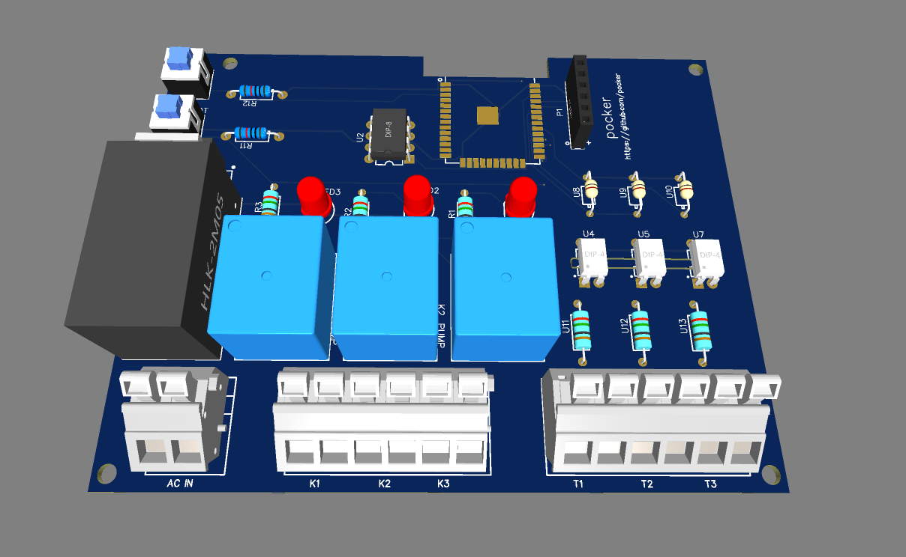
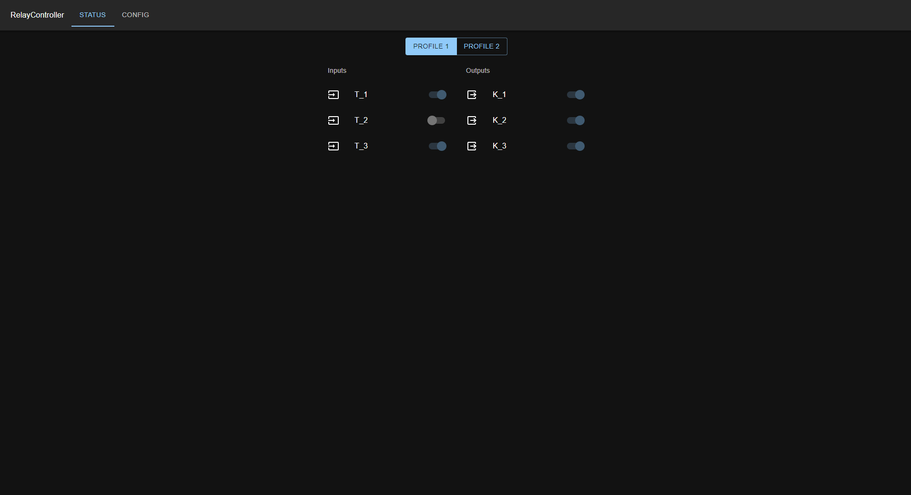
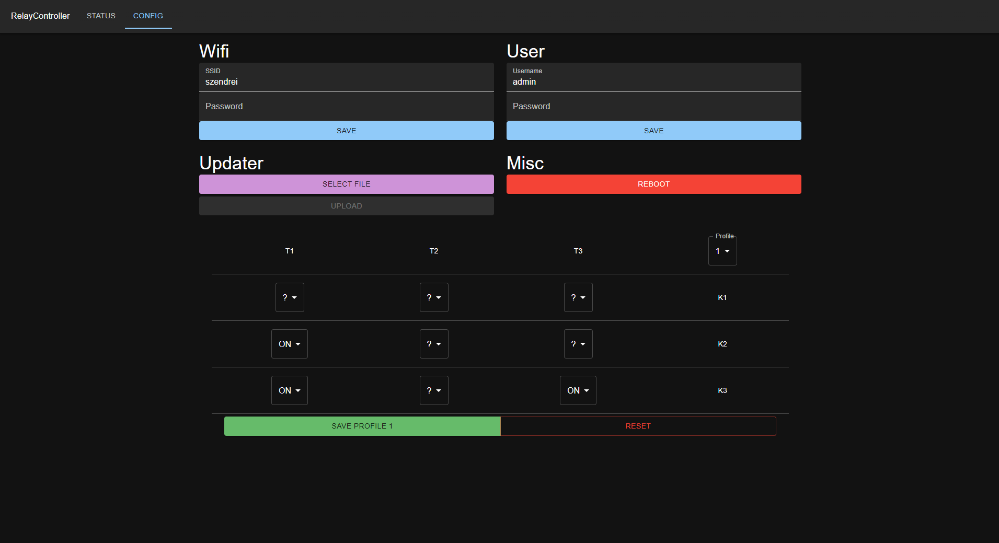

# Board information

> # ⚠️Danger
>⚡Please keep in mind that the board operates with high voltage. Do not touch the components!⚡

## ESP Pinout
| Name | IO     |
|------|--------|
| T_1  | GPIO21 |
| T_2  | GPIO19 |
| T_3  | GPIO18 |
| K_1  | GPIO22 |
| K_2  | GPIO17 |
| K_3  | GPIO16 |
| RX   | GPIO3  |  
| TX   | GPIO1  |
| RST  | EN     |
| BOOT | GPIO0  |

## Connectors
| Name  | Description                                |
|-------|--------------------------------------------|
| AC IN | Power input for the board. (220VAC)        |
| K*    | Outputs for the relays.(default state: NC) |
| T*    | 220V AC/DC signal inputs.                  |

## Default values
Once you connected to the device or the device is in your LAN you can access it via the [http://relay-controller.local](http://relay-controller.local) url.

### Wifi
By default the device will act as an AP. If the AP isn't available (after 1 min from boot) the device will enter into AP mode. 
* SSID: relay-controller
* password: 12345678
> If you change the wifi please reboot the device.
### User
Anonymous user has read access but can't change the config.
* username: admin
* password: admin
> Changeable in the config tab.

## Web UI

## Known bugs
- [ ] the LEDs of the K2 and K3 output is swapped.

# ESPHome firmware

The board now runs ESPHome (`oli-relay-controller.yaml`) instead of the
PlatformIO firmware above. Secrets (`wifi_ssid`, `wifi_password`,
`futes_rele_api_key`, `esphome_web_password`, `relay_ap_password`) come from
the ESPHome `secrets.yaml`.

## Relay logic

Relays follow the **Active Profile** select. Any input or profile change
restarts the update, so relays switch only once the inputs have been stable
for the **Relay Delay** (0–300 s).

| Profile | K1 | K2 | K3 |
|---|---|---|---|
| 0 (Hold/Manual) | unchanged | unchanged | unchanged |
| 1 | T1 | T2 | T3 |
| 2 | T1 | T1 | T1 & T3 |
| 3 | T1 | T2 \| T3 | T2 \| T3 |
| 4 | T1 & (T2 \| T3) | T1 & (T2 \| T3) | T1 & (T2 \| T3) |
| 5 | T2 \| T3 | T2 | T3 |
| 6 | T2 \| T3 \| hold | T2 \| T3 \| hold | T2 \| T3 \| hold |

**Profile 6 hold:** when T2|T3 drops while T1 is on, the pumps keep running
until T1 releases or **Hold Max Time** (1–120 min, default 30) is up. A new
T2|T3 demand ends it. The hold only starts on that falling edge, so T1 pulling
in again later does not restart the pumps. **Circulation Hold** shows whether
it is active.

In profile 0 the relays can be switched manually from Home Assistant. In the
other profiles a manual switch holds only until the next input or profile
change.
